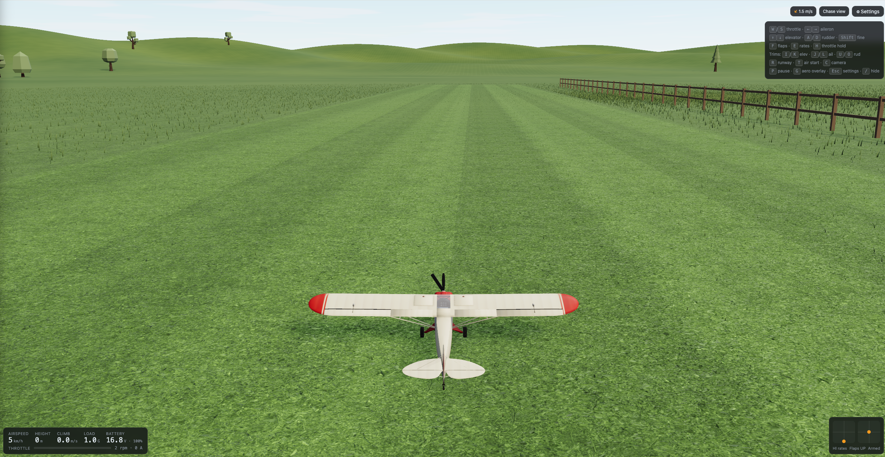

# RC Flight Sim

Fly a radio-controlled Piper Cub in your browser, from the pilot station like a real RC pilot.

**▶ Play: <https://hassan.umari.dev/rcwebsim/>**



Built with Vue, three.js (WebGPU) and Rapier, plus a custom aerodynamics model, so the 1.7 m PA-18 flies like the real foam model.

## Controls

| Key       | Action                      |
| --------- | --------------------------- |
| `W` / `S` | Throttle                    |
| `←` `→`   | Aileron                     |
| `↑` `↓`   | Elevator (↓ = nose up)      |
| `A` / `D` | Rudder                      |
| `F`       | Flaps                       |
| `R` / `T` | Reset on runway / air start |
| `C`       | Pilot / chase camera        |
| `Esc`     | Settings                    |

Gamepads and USB RC transmitters work too. Set them up in Settings → Controls.

Tip: it's a taildragger, so hold a little right rudder on the takeoff roll.

## Run locally

```bash
npm install
npm run dev   # http://localhost:5173
npm test
```

## More

- [docs/adr/](docs/adr/): design decisions
- [AGENTS.md](AGENTS.md) and [docs/agents/](docs/agents/): notes for coding agents
- [GLOSSARY.md](GLOSSARY.md): terms
- [ASSETS.md](ASSETS.md): credits. The PA-18 model is by helijah (CC-BY 4.0).
